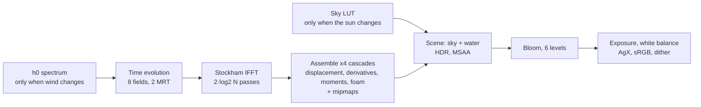

# Open Ocean: Real-Time Spectral Ocean (WebGL 2)

A single-file (`index.html`) real-time open-sea scene that runs in the browser. Every frame is computed on
the GPU. The wave field is synthesized with an inverse FFT, the sky comes from a single-scattering
atmosphere model, and the water surface is shaded from filtered slope statistics. There are no videos,
photos, pre-baked textures or build steps. The only dependency is Three.js r170, loaded from a CDN at a
pinned version.

> **Benchmark:** This project is a benchmark output generated from scratch by **Claude Opus 5.5**
> (`anthropic/claude-opus-5-5`) from a single Turkish prompt in an agentic environment. Details, the
> original prompt and the verification log are in the
> [Benchmark notes](#benchmark-notes-claude-opus-55) section.

---

## Contents

- [Running](#running)
- [Frame pipeline](#frame-pipeline)
- [1. Wave spectrum](#1-wave-spectrum)
- [2. Time evolution, choppy displacement and derivatives](#2-time-evolution-choppy-displacement-and-derivatives)
- [3. GPU FFT (Stockham, radix-2)](#3-gpu-fft-stockham-radix-2)
- [4. Cascades, band split and rotation](#4-cascades-band-split-and-rotation)
- [5. Jacobian and foam](#5-jacobian-and-foam)
- [6. Normal of the displaced surface](#6-normal-of-the-displaced-surface)
- [7. Filtering: LEAN-style slope moments and specular AA](#7-filtering-lean-style-slope-moments-and-specular-aa)
- [8. Sun reflection: anisotropic Beckmann](#8-sun-reflection-anisotropic-beckmann)
- [9. Sky reflection: visible-facet quadrature](#9-sky-reflection-visible-facet-quadrature)
- [10. Water body and crest transmission](#10-water-body-and-crest-transmission)
- [11. Atmosphere and sky](#11-atmosphere-and-sky)
- [12. Geometry, LOD and Earth curvature](#12-geometry-lod-and-earth-curvature)
- [13. Camera](#13-camera)
- [14. Time stepping](#14-time-stepping)
- [15. Exposure, white balance, bloom and tone mapping](#15-exposure-white-balance-bloom-and-tone-mapping)
- [16. Quality levels and cost](#16-quality-levels-and-cost)
- [17. Known limitations](#17-known-limitations)
- [Benchmark notes (Claude Opus 5.5)](#benchmark-notes-claude-opus-55)
- [References](#references)

---

## Running

```bash
python3 -m http.server 8000
# http://localhost:8000
```

The page uses ES modules and an import map, so open it through any local HTTP server, not `file://`. It
requires WebGL 2 and a floating-point render target (`EXT_color_buffer_float` or
`EXT_color_buffer_half_float`); otherwise the page shows a clear error message.

| Input | Behavior |
|---|---|
| Drag (mouse / touch) | Bounded, damped look-around: yaw ±80°, total pitch −38°…+18° |
| Double-click | Resets the view |
| `H` | Hides / shows the UI |
| Top-right button | Wind, wind direction, wave height, sun elevation/azimuth, exposure, quality, camera sway |

---

## Frame pipeline



For N = 256 the simulation costs 21 fullscreen passes per frame: 1 time evolution, 16 FFT stages (the four
cascades are transformed together in one atlas) and 4 assemble passes.

---

## 1. Wave spectrum

### 1.1 Surface model

The sea surface height is a sum of plane waves with random phases on a periodic tile:

```math
\eta(\mathbf{x},t)=\sum_{\mathbf{k}} \hat h(\mathbf{k},t)\,e^{i\,\mathbf{k}\cdot\mathbf{x}},
\qquad
\mathbf{k}=\frac{2\pi}{L}(n,m),\quad n,m\in\left[-\tfrac N2,\tfrac N2\right)
```

Wavenumber and angular frequency are linked by the deep-water dispersion relation:

```math
\omega(k)=\sqrt{g\,k},\qquad \frac{d\omega}{dk}=\frac{g}{2\omega},\qquad g=9.81\ \mathrm{m\,s^{-2}}
```

### 1.2 Wind sea: JONSWAP

```math
S_J(\omega)=\frac{\alpha g^2}{\omega^5}\exp\!\left[-\frac54\left(\frac{\omega_p}{\omega}\right)^4\right]\gamma^{\,r},
\qquad
r=\exp\!\left[-\frac{(\omega-\omega_p)^2}{2\sigma^2\omega_p^2}\right],
\qquad
\sigma=\begin{cases}0.07 & \omega\le\omega_p\\ 0.09 & \omega>\omega_p\end{cases}
```

For the wind sea $`\gamma = 3.3`$. The peak frequency and Phillips constant come from the wind speed
$`U`$ and a fetch of $`F = 40\ \text{km}`$. $`\omega_p`$ is bounded from below so the sea never goes past
a fully developed (Pierson–Moskowitz) state:

```math
\omega_p=\max\!\left(22\left(\frac{g^2}{U F}\right)^{1/3},\;0.855\,\frac{g}{U}\right),
\qquad
\alpha=0.076\left(\frac{U^2}{F g}\right)^{0.22}
```

### 1.3 Directional spreading: Donelan–Banner

```math
D(\omega,\theta)=\frac{\beta}{2\tanh(\beta\pi)}\,\operatorname{sech}^2(\beta\theta),
\qquad
\beta=\begin{cases}
2.61\,(\omega/\omega_p)^{1.3} & \omega/\omega_p<0.95\\
2.28\,(\omega/\omega_p)^{-1.3} & 0.95\le\omega/\omega_p<1.6\\
10^{\,-0.4+0.8393\exp[-0.567\ln((\omega/\omega_p)^2)]} & \text{otherwise}
\end{cases}
```

The normalization follows from $`\int_{-\pi}^{\pi}\operatorname{sech}^2(\beta\theta)\,d\theta = 2\tanh(\beta\pi)/\beta`$,
so $`\int D\,d\theta = 1`$ and the spreading does not change the energy. At high frequencies
$`\beta`$ shrinks: short waves spread in all directions, while waves near the peak stay aligned with the
wind. This is the physical mechanism that rules out "a few repeating waves all moving the same way".

### 1.4 Swell

Swell from a distant storm is a second, narrow JONSWAP component: $`\gamma_s = 4`$,
$`T_p = 11\ \text{s}`$ ($`\omega_p = 0.5712\ \text{rad/s}`$, $`\lambda_p \approx 189\ \text{m}`$), fixed
spreading $`\beta_s = 4`$ ($`\operatorname{sech}^2`$ half-power half-width of about 13°), arriving from
azimuth −24°. Its amplitude is solved from a target significant wave height $`H_s = 0.8\ \text{m}`$. Using
$`m_0 = \alpha g^2 / (5\omega_p^4)`$ for the PM shape and the approximate JONSWAP peak-enhancement factor
$`1/(1-0.287\ln\gamma)`$:

```math
m_0=\frac{H_s^2}{16},
\qquad
\alpha_s=\frac{5\,\omega_p^4\,m_0}{g^2}\,\bigl(1-0.287\ln\gamma_s\bigr)\approx1.33\times10^{-4}
```

### 1.5 From frequency to wavenumber

In polar coordinates $`d^2k = k\,dk\,d\theta`$, so the two-dimensional wavenumber spectrum is:

```math
S(\mathbf{k})=\bigl[S_J^{\text{wind}}(\omega)\,D(\omega,\theta-\theta_w)+S_J^{\text{swell}}(\omega)\,D_s(\theta-\theta_s)\bigr]\,
\frac{d\omega}{dk}\,\frac1k\;e^{-k^2\ell^2},
\qquad \ell=6\ \text{mm}
```

This preserves $`\iint S(\mathbf{k})\,d^2k=\int S(\omega)\,d\omega=m_0`$. The factor $`e^{-k^2\ell^2}`$
gently suppresses energy near the Nyquist limit of the smallest cascade.

### 1.6 Discretization and random amplitudes

For each $`\mathbf{k}`$, independent standard normals $`\xi_r,\xi_i`$ are drawn once on the CPU
(fixed-seed `mulberry32` + Box–Muller):

```math
h_0(\mathbf{k})=\frac{\xi_r+i\,\xi_i}{2}\,\Delta k\,\sqrt{S(\mathbf{k})},
\qquad
\Delta k=\frac{2\pi}{L},
\qquad
\mathbb E|h_0|^2=\tfrac12 S(\mathbf{k})\,\Delta k^2
```

A real surface needs Hermitian symmetry. The time-dependent amplitude is built as:

```math
\hat h(\mathbf{k},t)=h_0(\mathbf{k})\,e^{i\omega t}+\overline{h_0(-\mathbf{k})}\,e^{-i\omega t}
\;\;\Rightarrow\;\;
\hat h(-\mathbf{k},t)=\overline{\hat h(\mathbf{k},t)}
```

Variance check (cross terms vanish by independence):

```math
\operatorname{Var}\eta=\sum_{\mathbf k}\mathbb E|\hat h|^2
=\sum_{\mathbf k}\tfrac12\bigl[S(\mathbf k)+S(-\mathbf k)\bigr]\Delta k^2
=\sum_{\mathbf k}S(\mathbf k)\,\Delta k^2\approx m_0
```

So the rendered waves have the $`H_s = 4\sqrt{m_0}`$ implied by the spectrum. The self-conjugate Nyquist
row and column ($`n = N/2`$ or $`m = N/2`$) are zeroed so they cannot break the Hermitian condition.

Values from numerical integration for the default and extreme settings (cascade bands for N = 256):

| $`U`$ (m/s) | $`\omega_p`$ | $`\lambda_p`$ (m) | $`T_p`$ (s) | $`\alpha`$ | Total $`H_s`$ (m) | Resolved slope variance | Cox–Munk $`0.003+0.00512U`$ |
|---:|---:|---:|---:|---:|---:|---:|---:|
| 2 | 4.194 | 3.5 | 1.50 | 0.00606 | 0.81 | 0.0123 | 0.0132 |
| **6** | **1.622** | **23.4** | **3.87** | **0.00983** | **1.14** | **0.0290** | **0.0337** |
| 10 | 1.368 | 32.9 | 4.59 | 0.01231 | 1.51 | 0.0382 | 0.0542 |
| 14 | 1.223 | 41.2 | 5.14 | 0.01427 | 1.91 | 0.0459 | 0.0747 |

In light wind, the resolved mean-square slope is close to the value derived from Cox & Munk's (1954) sun
glitter measurements. The remaining gap is the contribution of the unsimulated capillary waves (see §7).

### 1.7 Seamless loop and phase precision

Frequencies are rounded down to multiples of $`\omega_0 = 2\pi/T`$ ($`T = 600\ \text{s}`$,
$`\omega_0 = 0.01047\ \text{rad/s}`$):

```math
\tilde\omega=\omega_0\left\lfloor\frac{\omega}{\omega_0}\right\rfloor
\;\;\Rightarrow\;\;
\eta(\mathbf x,t+T)=\eta(\mathbf x,t)
```

Time is kept in double precision on the CPU as $`t \bmod T`$. The largest phase is about
$`\sqrt{g\,\pi N/L_3}\;T \approx 2.2\times10^4`$ rad, where float32 still resolves about
$`2\times10^{-3}`$ rad. This keeps phases from degrading over hours of runtime. Every animation angle in
the foam pattern is also a multiple of $`\omega_0`$, so the loop wrap is invisible.

---

## 2. Time evolution, choppy displacement and derivatives

Surface points also move horizontally, in Lagrangian form:
$`\mathbf x = \mathbf x_0 + \lambda\,\mathbf D(\mathbf x_0,t)`$.

```math
\mathbf D(\mathbf x,t)=\sum_{\mathbf k} i\,\frac{\mathbf k}{k}\,\hat h(\mathbf k,t)\,e^{i\mathbf k\cdot\mathbf x}
```

Sign check: for a single wave $`\eta = A\cos\varphi`$ with $`\varphi = kx-\omega t`$, this gives
$`D_x = -A\sin\varphi`$. Points just ahead of the crest ($`\varphi>0`$) move toward it, and
$`J = 1-\lambda A k\cos\varphi`$ drops below 1 at the crest. That is the behavior of the Gerstner wave
$`x = x_0 - A\sin(kx_0-\omega t)`$: crests compress and sharpen, troughs widen. This asymmetry is what keeps
the water from looking like a breathing rubber sheet.

The derivatives needed for shading and foam are taken analytically from the same spectrum:

```math
\partial_x\eta=\sum i k_x\hat h\,e^{i\mathbf k\cdot\mathbf x},\quad
\partial_z\eta=\sum i k_z\hat h\,e^{i\mathbf k\cdot\mathbf x},
```

```math
\partial_x D_x=\sum -\frac{k_x^2}{k}\hat h\,e^{i\mathbf k\cdot\mathbf x},\quad
\partial_z D_z=\sum -\frac{k_z^2}{k}\hat h\,e^{i\mathbf k\cdot\mathbf x},\quad
\partial_z D_x=\partial_x D_z=\sum -\frac{k_xk_z}{k}\hat h\,e^{i\mathbf k\cdot\mathbf x}
```

### Two real fields per complex IFFT

If $`a`$ and $`b`$ are real fields, their spectra $`A`$ and $`B`$ are Hermitian and
$`\mathcal F^{-1}[A+iB] = a+i\,b`$. So the 8 real fields come out of 4 complex transforms, which fit in
2 RGBA targets (MRT):

| Channel | Complex input | After IFFT (real, imag) |
|---|---|---|
| `o0.xy` | $`\hat D_x + i\,\hat\eta`$ | $`(D_x,\ \eta)`$ |
| `o0.zw` | $`\hat D_z + i\,\widehat{\partial_x\eta}`$ | $`(D_z,\ \partial_x\eta)`$ |
| `o1.xy` | $`\widehat{\partial_z\eta} + i\,\widehat{\partial_xD_x}`$ | $`(\partial_z\eta,\ \partial_xD_x)`$ |
| `o1.zw` | $`\widehat{\partial_zD_z} + i\,\widehat{\partial_zD_x}`$ | $`(\partial_zD_z,\ \partial_zD_x)`$ |

In complex arithmetic $`A+iB = (A_r - B_i,\; A_i + B_r)`$.

---

## 3. GPU FFT (Stockham, radix-2)

The inverse DFT is unnormalized because amplitudes are already defined per mode:
$`x_j = \sum_k X_k\,e^{+2\pi i jk/N}`$. For each stage $`s = 0,\dots,\log_2 N - 1`$ and
$`S = 2^{s+1}`$, every output index $`j`$ is computed as:

```math
e=\left\lfloor \tfrac{j}{S}\right\rfloor\tfrac S2+\left(j \bmod \tfrac S2\right),
\qquad
X^{(s+1)}_j=X^{(s)}_e+W\,X^{(s)}_{e+N/2},
\qquad
W=\exp\!\left(+2\pi i\,\frac{j \bmod S}{S}\right)
```

This Stockham "autosort" form needs no bit-reversal permutation: natural-order input produces
natural-order output. The kernel was checked numerically against a naive IDFT during development: max
absolute error $`2.2\times10^{-16}`$ for N = 4 and $`6.9\times10^{-13}`$ for N = 256 (float64).

Implementation details:

- The four cascades sit side by side in one $`4N \times N`$ atlas. Horizontal stages compute the index
  inside the cascade tile (`base = (x / N) * N`); vertical stages never cross a tile boundary anyway.
  So 4 cascades × 4 complex fields are processed in a single draw per stage.
- $`2\log_2 N`$ passes in total (16 for N = 256), each with 2 MRT outputs, ping-ponged between two
  targets.
- Precision is FP32 when `EXT_color_buffer_float` is available and FP16 otherwise (mobile fallback).
- Reads use `texelFetch`, so float texture filtering (`OES_texture_float_linear`) is not required.

---

## 4. Cascades, band split and rotation

| Cascade | $`L`$ (m) | Rotation (rad) | Texel (N = 256) | Band (N = 256) | Foam weight |
|---:|---:|---:|---:|---|---:|
| 0 | 1013.0 | 0.00 | 3.96 m | $`\lambda > 28.9`$ m (swell + long wind waves) | 0.35 |
| 1 | 173.3 | 0.47 | 0.677 m | 5.18 – 28.9 m (dominant wind waves) | 1.30 |
| 2 | 31.07 | 1.21 | 12.1 cm | 0.955 – 5.18 m (short waves) | 0.50 |
| 3 | 5.73 | 2.39 | 2.2 cm | 4.5 cm – 0.955 m (ripples) | 0 |

The band boundary is chosen so that $`m`$ wavelengths fit in the next cascade's tile:

```math
k_{b,i}=\frac{2\pi m}{L_{i+1}},\qquad m=\begin{cases}6 & N=256\\4 & N=128\end{cases},
\qquad
\text{cascade } i:\ k\in[k_{b,i-1},\,k_{b,i})
```

With this choice each cascade samples its band at roughly 7–8 texels per wavelength, and the bands do not
overlap, so no energy is counted twice.

**Rotation.** Cascade $`c`$ is sampled at $`\mathbf u = R(\theta_c)\,\mathbf x / L_c`$. The repeat axes of
the four tiles never line up, and their sizes are not integer multiples of each other, so tiling cannot be
spotted. In the local frame $`e^{i\mathbf k_w\cdot\mathbf x} = e^{i(R\mathbf k_w)\cdot\mathbf u}`$, so to
keep the world-space wind direction the local spectrum is generated with wind angle
$`\theta_w + \theta_c`$. Transforms back to the world frame:

```math
\mathbf D_w=R^{\mathsf T}\mathbf D_\ell,\qquad
\nabla_w\eta=R^{\mathsf T}\nabla_\ell\eta,\qquad
T_w=R^{\mathsf T}\,T_\ell\,R
```

For a symmetric $`2\times2`$ tensor $`(t_{xx},t_{zz},t_{xz})`$ with $`c=\cos\theta`$, $`s=\sin\theta`$:

```math
\begin{aligned}
t'_{xx}&=t_{xx}c^2+2t_{xz}sc+t_{zz}s^2\\
t'_{zz}&=t_{xx}s^2-2t_{xz}sc+t_{zz}c^2\\
t'_{xz}&=(t_{zz}-t_{xx})sc+t_{xz}(c^2-s^2)
\end{aligned}
```

This transform is applied to both the Jacobian terms and the slope covariance in §7.

**Assemble pass.** Each cascade is unpacked into three filterable, mipmapped RGBA16F textures with
`RepeatWrapping` and anisotropic filtering:

| Texture | R | G | B | A |
|---|---|---|---|---|
| displacement | $`\lambda D_x`$ | $`\eta`$ | $`\lambda D_z`$ | $`\lambda\,\partial_zD_x`$ |
| derivatives | $`\partial_x\eta`$ | $`\partial_z\eta`$ | $`\lambda\,\partial_xD_x`$ | $`\lambda\,\partial_zD_z`$ |
| moments | $`(\partial_x\eta)^2`$ | $`(\partial_z\eta)^2`$ | $`\partial_x\eta\,\partial_z\eta`$ | foam |

---

## 5. Jacobian and foam

The Jacobian of the horizontal displacement map measures how much a surface element is compressed:

```math
J=(1+\lambda D_{xx})(1+\lambda D_{zz})-\lambda^2D_{xz}^2
```

$`J<1`$ means compression and $`J\le0`$ means the surface folds over itself. Foam is generated from
$`1-J`$ with a wind-dependent threshold:

```math
g=\operatorname{clamp}\!\left(\left(\frac{1-J}{\nu}-\tau(U)\right)G,\;0,\;1\right),
\qquad
\tau(U)=0.27-0.005\,U,\qquad G=10
```

**Why does the threshold depend on wind?** In a linear spectrum the steepness of the saturated short-wave
range barely changes with wind, and the Jacobian quantiles read back from the GPU confirmed they are almost
independent of wind speed. A fixed threshold therefore cannot reproduce whitecap coverage that grows with
wind (Monahan: $`W\propto U^{3.4}`$). The threshold is tied to wind to mimic that observed growth.

**Amplitude normalization.** The wave height slider $`a`$ scales amplitude without lengthening the waves,
so it raises steepness in a non-physical way. To compensate:

```math
\lambda(a)=\frac{1}{\max(1,\sqrt a)},\qquad \nu(a)=\lambda(a)\,a^{0.8}
```

For $`a>1`$ the horizontal displacement is reduced so crests do not fold into loops, and the foam
criterion is normalized to scale as $`\propto a^{0.2}`$. Coverage then follows the wind instead of
exploding with the multiplier.

**Time integration (Lagrangian).** Foam is stored in the undisplaced $`\mathbf x_0`$ space, so it rides
the orbital motion together with the surface particle and needs no separate advection. Each frame:

```math
\begin{aligned}
f' &= \operatorname{mix}\!\bigl(f_c,\ \tfrac14\textstyle\sum_{4\text{-neighbors}} f,\ \min(2.5\,\Delta t,\ 0.5)\bigr)\\
f  &\leftarrow \operatorname{clamp}\!\bigl(f'\,e^{-\kappa\Delta t}+g\,\min(5\Delta t,1),\ 0,\ 1\bigr),\qquad \kappa=0.25\ \mathrm{s^{-1}}
\end{aligned}
```

The neighbor average corresponds to diffusion $`\partial_tf \approx 0.625\,\Delta x^2\,\nabla^2 f`$
(about $`0.29\ \mathrm{m^2/s}`$ in cascade 1). Aging foam patches spread, thin out and decay on a
$`\tau = 1/\kappa = 4`$ s scale. The diffusion also stops single-texel peaks from turning into star-shaped
blobs under bilinear magnification.

**On-screen combination.** The fragment shader also computes instantaneous crest foam from the total
Jacobian without the capillary cascade, $`M_F = I+\sum_{c\le2}T_{w,c}`$:
$`c_F = \operatorname{clamp}\bigl(((1-\det M_F)/\nu - \tau - 0.07)\cdot 4\bigr)`$. The final amount is:

```math
a_f=\operatorname{clamp}\Bigl(\max\bigl(\textstyle\sum_c w_c f_c,\ c_F\bigr)\,(0.45+1.1\,p)\Bigr)
```

where $`p`$ is low-frequency value noise (large-scale irregularity). The visible mask is a soft cut at
threshold $`1-a_f`$ over a two-part pattern stretched along the wind: blotches (value noise) and lace
(animated Voronoi $`F_2-F_1`$ cell walls). Fresh foam is dense and opaque; as it decays the threshold
rises until only the lace network is left. As the pixel footprint (`fwidth`) grows, the pattern fades to
its mean, so it does not alias in the distance. Thin foam is tinted slightly blue-green so the water
shows through.

---

## 6. Normal of the displaced surface

The normal has to match the actual geometry. For $`\mathbf x = \mathbf x_0 + \mathbf D(\mathbf x_0)`$ the
chain rule gives:

```math
M=\frac{\partial\mathbf x}{\partial\mathbf x_0}=I+\begin{pmatrix}D_{xx}&D_{xz}\\D_{xz}&D_{zz}\end{pmatrix},
\qquad
\nabla_{\mathbf x}\eta=M^{-\mathsf T}\,\nabla_{\mathbf x_0}\eta=M^{-1}\mathbf g
```

$`\mathbf D`$ is the gradient of a potential, so $`D_{xz}=D_{zx}`$ and $`M`$ is symmetric. In code:

```math
\mathbf s=\frac{1}{\max(\det M,0.2)}\begin{pmatrix}m_{11}g_x-m_{01}g_z\\ m_{00}g_z-m_{01}g_x\end{pmatrix},
\qquad
|\mathbf s|\le2.5,
\qquad
\mathbf n=\frac{(-s_x,\,1,\,-s_z)}{\sqrt{1+|\mathbf s|^2}}
```

The full inverse is used instead of the diagonal approximation ($`g_x/(1+D_{xx})`$), so compressed crests
steepen correctly even for waves that are not axis-aligned. The derivatives of all cascades are first
rotated into the world frame and summed; the inverse is taken on that sum.

---

## 7. Filtering: LEAN-style slope moments and specular AA

In the distance a single pixel covers thousands of small waves. Mipmapping a normal map drives the mean
slope toward zero, but the lost slope variance has to come back as roughness; otherwise the far sea turns
into a mirror and the glints flicker. The first and second slope moments are mipmapped (Olano & Baker,
LEAN mapping):

```math
\Sigma_c=\mathbb E[\mathbf s\mathbf s^{\mathsf T}]-\mathbb E[\mathbf s]\,\mathbb E[\mathbf s]^{\mathsf T}
\quad(\text{via hardware filtering, in the cascade frame})
```

Cascades are treated as independent, so their covariances add:

```math
\Sigma=\sum_c R_c^{\mathsf T}\Sigma_cR_c\;+\;\Sigma_{AA}\;+\;\sigma_b^2 I,
\qquad
|\Sigma_{xz}|\le0.95\sqrt{\Sigma_{xx}\Sigma_{zz}}
```

- **Specular AA** (Kaplanyan / Tokuyoshi style): slope variation inside the pixel becomes roughness.
  $`\Sigma_{AA}=0.3\,(\partial_{\hat x}\mathbf s\,\partial_{\hat x}\mathbf s^{\mathsf T}+\partial_{\hat y}\mathbf s\,\partial_{\hat y}\mathbf s^{\mathsf T})`$,
  each component clamped to 0.06 ($`\hat x,\hat y`$ are screen axes, via `dFdx`/`dFdy`).
- **Sub-grid variance:** $`\sigma_b^2 = 0.0005+0.00007\,U`$ per axis. By Cox–Munk, the residual of the
  unsimulated capillaries would be roughly 0.002 per axis (table in §1.6). The value is kept deliberately
  lower so near-field glints stay individually visible instead of merging. This is a visual choice, not a
  physical one.
- **Geometry LOD:** the vertex shader reads displacement from a mip level chosen by the cell size,
  $`\text{lod}_c = \max\bigl(\log_2(c_{\text{cell}}\,N/L_c)+0.5,\ 0\bigr)`$, so waves the mesh cannot
  resolve do not alias in the geometry.
- Textures are sampled with anisotropic filtering (4–16× depending on quality).

---

## 8. Sun reflection: anisotropic Beckmann

For a Gaussian slope distribution with mean $`\bar{\mathbf s}`$ and covariance $`\Sigma`$, the normal
distribution function is the slope-space probability density combined with the solid-angle Jacobian
($`\cos^4\theta_h`$):

```math
D(\mathbf h)=\frac{\exp\!\left[-\tfrac12(\mathbf s_h-\bar{\mathbf s})^{\mathsf T}\Sigma^{-1}(\mathbf s_h-\bar{\mathbf s})\right]}{2\pi\sqrt{\det\Sigma}\;\cos^4\theta_h},
\qquad
\mathbf s_h=-\frac{(h_x,h_z)}{h_y}
```

Masking-shadowing uses the Smith $`\Lambda`$ for Beckmann (the Walter et al. 2007 rational
approximation), with the variance projected onto each direction's azimuth, and the height-correlated
$`G_2`$:

```math
\sigma_\varphi^2=\hat{\boldsymbol\varphi}^{\mathsf T}\Sigma\,\hat{\boldsymbol\varphi},\quad
a=\frac{\cot\theta}{\sqrt2\,\sigma_\varphi},\quad
\Lambda(a)\approx\begin{cases}\dfrac{1-1.259a+0.396a^2}{3.535a+2.181a^2}&a<1.6\\[4pt]0&a\ge1.6\end{cases},
\quad
G_2=\frac{1}{1+\Lambda(\mathbf v)+\Lambda(\mathbf l)}
```

The macro normal points up, $`\cos\theta_l`$ cancels, and the radiance reflected from the sun is:

```math
L_{\odot}=E_\odot\,\frac{F(\mathbf h\cdot\mathbf v)\,D(\mathbf h)\,G_2}{4\max(v_y,\,0.015)}
```

This is the microfacet-BRDF form of the Cox–Munk glitter equation. Near the camera $`\Sigma`$ is small and
you get individual sharp glints; far away the filtered variance grows and the glints merge into a
continuous path that widens toward the horizon. Together, $`1/v_y`$ and $`G_2`$ make the path brighten
toward the horizon and then get masked. Fresnel is Schlick's approximation; for $`n = 1.333`$,
$`F_0 = \bigl(\tfrac{n-1}{n+1}\bigr)^2 = 0.0204`$:

```math
F(\cos\theta)=F_0+(1-F_0)(1-\cos\theta)^5,\qquad F_0=0.02
```

The term is clamped at $`3\times10^4`$ to avoid half-float overflow.

---

## 9. Sky reflection: visible-facet quadrature

The far sea looks darker than the sky at the horizon because, at grazing view angles, facets tilted
toward the viewer dominate. Those facets reflect higher, darker-blue sky, with lower Fresnel. This is
modeled with a 3-point Gauss–Hermite quadrature along the view azimuth $`\hat{\mathbf v}_h`$ (nodes
$`0,\pm\sqrt3`$, weights $`\tfrac23,\tfrac16,\tfrac16`$):

```math
\mathbf s_t=\bar{\mathbf s}+t\sqrt3\,\sigma_v\,\hat{\mathbf v}_h,\qquad
\sigma_v^2=\hat{\mathbf v}_h^{\mathsf T}\Sigma\,\hat{\mathbf v}_h,\qquad t\in\{-1,0,1\}
```

The facet area projected toward the viewer, per unit horizontal area:

```math
\frac{\mathbf n\cdot\mathbf v}{\mathbf n\cdot\hat{\mathbf y}}=v_y-\mathbf s\cdot\mathbf v_{xz}
\quad\Rightarrow\quad
w_t\propto\omega_t\max\bigl(v_y-\mathbf s_t\cdot\mathbf v_{xz},\,0\bigr)
```

```math
L_{\text{refl}}=\frac{\sum_t w_t\,F(\mathbf n_t\!\cdot\!\mathbf v)\,L_{\text{sky}}(\operatorname{reflect}(-\mathbf v,\mathbf n_t),\ \text{lod})}{\sum_t w_t},
\qquad
\bar F=\frac{\sum_t w_tF_t}{\sum_t w_t}
```

The angular blur across the view plane, plus what falls between the nodes, is handled with the sky LUT
mip level:

```math
b=2\sqrt{\sigma_t^2+\tfrac14\sigma_v^2},\quad
\sigma_t^2=\operatorname{tr}\Sigma-\sigma_v^2,\quad
\text{lod}=\operatorname{clamp}\bigl(\log_2(b/\Delta\theta),\,0,\,7\bigr),\quad
\Delta\theta=\frac{2\pi}{256}
```

Reflected directions that fall below the horizon are mirrored with $`|R_y|`$, a crude stand-in for a
second reflection off another wave.

---

## 10. Water body and crest transmission

In deep, clear open ocean, the upwelling light from the water body is weighted by Fresnel transmission:

```math
L_{\text{body}}=\rho\left[E_\odot\,\frac{0.55\,\mu_s+0.45\max(\mathbf n\!\cdot\!\mathbf l,0)}{\pi}+\bar L_{\text{sky}}\right],
\qquad
\rho=\operatorname{mix}\bigl(\rho_A,\rho_B,\ 0.6(1-\mathbf n\!\cdot\!\mathbf v)^2\bigr)
```

$`\rho_A = (0.0028,\,0.0125,\,0.0290)`$ is navy at steep view angles and $`\rho_B = (0.0030,\,0.0215,\,0.0270)`$
is petrol blue at grazing angles. In magnitude this is consistent with $`\rho = \pi R_{rs}`$ and a typical
open-ocean blue-band $`R_{rs}\sim 0.01\ \mathrm{sr^{-1}}`$. $`\bar L_{\text{sky}}`$ is the top mip of the
sky LUT (hemispherical average). Faces turned toward the sun receive more light, so the water color is
not a constant: it varies with view angle, surface orientation and lighting.

Crest transmission imitates the green-blue light that filters through thin wave crests when looking
toward the sun:

```math
L_{\text{sss}}=\mathbf c_{\text{sss}}\,E_\odot\;h^2\;\max(-\mathbf v\!\cdot\!\mathbf l,0)^3\;\bigl(\tfrac12-\tfrac12\,\mathbf n\!\cdot\!\mathbf l\bigr)^2,
\qquad
h=\operatorname{clamp}\!\left(\frac{\eta}{\max(0.15,\,H_s a/2)},0,1.6\right)
```

with $`\mathbf c_{\text{sss}}=(0.010,\,0.060,\,0.050)`$. The three factors mean, in order: only crests,
only when looking against the sun, and only faces turned away from the sun (lit from behind). Total
surface radiance:

```math
L_w=L_{\text{refl}}+(1-\bar F)\bigl(L_{\text{body}}+L_{\text{sss}}\bigr)+L_{\odot}
```

There is no visible sea floor and no caustics pattern stuck onto the surface.

---

## 11. Atmosphere and sky

### 11.1 Medium

Earth radius $`R_g = 6360`$ km, top of atmosphere $`R_t = 6460`$ km, observer 5 m above sea level.
Density profiles and coefficients (in $`\mathrm{m^{-1}}`$):

```math
\rho_R=e^{-h/8000},\quad
\rho_M=e^{-h/1200},\quad
\rho_O=\max\!\bigl(0,\,1-|h-25\,\mathrm{km}|/15\,\mathrm{km}\bigr)
```

```math
\beta_R=(5.802,\,13.558,\,33.1)\times10^{-6},\quad
\beta_M^{s}=1.1\times10^{-5},\quad
\beta_M^{e}=1.11\,\beta_M^{s},\quad
\beta_O^{a}=(0.650,\,1.881,\,0.085)\times10^{-6}
```

$`\beta_M^s`$ is about 2.75× the clear-air value and represents a light marine haze. Transmittance is
$`T(a,b)=\exp\bigl(-\int_a^b\sigma_e\,ds\bigr)`$.

### 11.2 Single scattering plus a multiple-scattering approximation

```math
L(\mathbf v)=\int_0^{t_{\max}}T(0,t)\,T_\odot(t)\bigl[\beta_R\rho_R\,P_R(\mu)+\beta_M^s\rho_M\,P_M(\mu)\bigr]E_\odot\,dt
\;+\;\int_0^{t_{\max}}T(0,t)\bigl[\beta_R\rho_R+\beta_M^s\rho_M\bigr]\psi_{ms}\,dt
```

```math
P_R(\mu)=\frac{3}{16\pi}(1+\mu^2),\qquad
P_M(\mu)=\frac{3}{8\pi}\frac{(1-g^2)(1+\mu^2)}{(2+g^2)(1+g^2-2g\mu)^{3/2}},\quad g=0.78
```

$`P_M`$ is the Cornette–Shanks phase function. The second integral is an isotropic, empirical source term
for multiple scattering: $`\psi_{ms}=0.02(\sin\theta_\odot+0.05)^{0.6}`$. With single scattering only, the
horizon came out peach-gray and washed out; this term restores the blue and the neutral white at the
horizon. The integral uses a midpoint rule with quadratic spacing so the dense layer near the ground is
sampled well: 40 steps along the view ray ($`t_i = t_{\max}(i/40)^2`$) and 16 along the sun ray. Sun rays
that hit the ground get zero transmittance.

### 11.3 Sky LUT

A 256×128 LUT covers only the upper hemisphere:

```math
u=\frac{\phi}{2\pi}+\frac12,\qquad v=\sqrt{\frac{2\,\theta_e}{\pi}}\quad\Rightarrow\quad \frac{d\theta_e}{dv}=\pi v
```

The square-root mapping concentrates resolution at the horizon, where the color changes fastest and where
grazing reflections sample. The LUT is recomputed and mipmapped only when the sun changes. The sky
background and the water reflection read the same LUT, so the sky, sun and reflections all agree on the
light direction. `textureLod` is used everywhere because of the derivative discontinuity at the azimuth
seam.

### 11.4 Sun

Surface irradiance $`E_\odot = T_\odot`$ (with $`E_0 = 1`$ at the top of the atmosphere) is computed on
the CPU with a 2000-step midpoint integral using the same coefficients; this is where the reddening of a
low sun comes from. Disk radiance with limb darkening:

```math
L_{\text{disk}}=\frac{E_\odot}{\pi\theta_\odot^2}\,\Bigl[1-0.56(1-\mu)-0.2(1-\mu)^2\Bigr],
\qquad
\mu=\sqrt{1-(\theta/\theta_\odot)^2},\quad
\theta_\odot=4.654\ \text{mrad}
```

The disk edge is antialiased with a one-pixel-wide `smoothstep` in angle.

### 11.5 Aerial perspective

Over the distance $`d`$ to the camera, the water surface blends into the horizon color, assuming a
homogeneous layer. In a homogeneous medium with source function $`J`$,
$`L(d) = L_0e^{-\beta d}+\tfrac{J}{\beta}\bigl(1-e^{-\beta d}\bigr)`$, and in the limit $`d\to\infty`$,
$`J/\beta`$ is the horizon radiance at that azimuth:

```math
L=L_w\,e^{-(\beta_R+\beta_M^e)d}+L_{\text{sky}}(\phi,\ \theta_e=0)\,\bigl(1-e^{-(\beta_R+\beta_M^e)d}\bigr)
```

In the limit, the far sea converges exactly to the horizon sky in the same direction. This guarantees
continuity at the horizon line and keeps the fog from looking like a wall at short range. In the blue
channel, transmittance to the geometric horizon (7.6 km) is about 0.71: the horizon softens but does not
disappear.

---

## 12. Geometry, LOD and Earth curvature

The mesh is a camera-centered polar grid. The camera does not move horizontally, so the mesh is fixed in
world space and never swims. Ring radii:

```math
r_{i+1}=r_i+r_i\max\!\left(a,\ \frac{p\,r_i}{h}\right),
\qquad a=\frac{2\pi}{S_{\text{seg}}},\quad h=4.5\ \text{m}
```

- **Near zone** ($`r<r^*`$): $`\Delta r = a\,r`$; cells are square and the spacing grows exponentially.
- **Far zone**: $`\Delta r = p\,r^2/h`$. A point at distance $`r`$ sits $`\delta\approx h/r`$ below the
  horizon, so $`|d\delta| = h\,\Delta r/r^2 = p`$: every ring covers a constant screen angle ($`p`$,
  about 1–2 pixels). The crossover radius is $`r^* = a\,h/p`$ (≈ 21–25 m).
- Odd rings are offset by $`a/2`$, so triangles are close to equilateral and no radial "spoke" pattern
  points at the camera.
- `position.y` stores the cell size for LOD: $`c = \sqrt{\Delta r\cdot r\,a}`$ (geometric mean of radial
  and angular spacing).

**Earth curvature.** $`y \mathrel{-}= r^2/(2R_\oplus)`$. For $`h = 4.5`$ m:

```math
d_{\text{horizon}}=\sqrt{2hR_\oplus}\approx7.57\ \text{km},\qquad
\delta_{\text{horizon}}=\sqrt{2h/R_\oplus}\approx1.19\ \text{mrad}\ (0.068^\circ)
```

The mesh extends to 26 km (53 m of drop at the edge). The surface beyond the geometric horizon is hidden
by nearer water in the depth test, so the mesh edge is never visible from any angle. The ~1 px band
between the horizon and the mesh is filled by the sky pass with the horizon radiance.

---

## 13. Camera

- **Framing:** the horizon sits 35% from the top.
  $`\theta_0 = -\arctan\bigl(\tan(\mathrm{fov}/2)(1-2\cdot0.35)\bigr)`$, i.e. −7.96° at a 50° vertical FOV.
- **Portrait screens:** $`\mathrm{fov}=\min\bigl(74^\circ,\,2\arctan(1.2\tan25^\circ/\text{aspect})\bigr)`$,
  plus an initial +12° yaw so the glitter path stays in frame.
- **Damping:** $`x \leftarrow x+(x^\star-x)(1-e^{-7\Delta t})`$, independent of frame rate.
- **Sway:** a sum of low-frequency sines with non-commensurate periods. Amplitudes: roll 0.32°,
  pitch 0.22°, yaw 0.15°, heave 0.13 m. Toggling it blends smoothly with $`1-e^{-1.5\Delta t}`$.
- **Never under water:** the pitch limits keep the camera from looking straight down, and the height rises
  smoothly with the sea state: $`h=\max\bigl(4.5,\ 1.5+1.5\,H_s\,a\bigr)`$.

---

## 14. Time stepping

$`\Delta t = \min(\Delta t_{\text{real}},\,0.1\ \text{s})`$. The reference time is reset on
`visibilitychange`, so there is no time jump when returning to the tab. Simulation time is kept as
$`t \bmod 600`$ (§1.7). Foam generation, decay and diffusion and camera smoothing all scale with
$`\Delta t`$, so results do not depend on frame rate.

---

## 15. Exposure, white balance, bloom and tone mapping

**Auto-exposure.** When the sun changes, the top mip of the LUT (the sky average) is drawn into a 1×1
target and read back once. There is no per-frame CPU–GPU sync.

```math
k=0.3\cdot2^{\,\mathrm{EV}}\cdot\bar L_Y^{-0.85}
```

The 0.85 exponent means partial adaptation: a sunset is not brightened to look like daylight and still
gets darker. Measured sky keys: $`\bar L_Y = 0.0109`$ at 2° sun ($`k\approx14.0`$), 0.0244 at 8°,
0.0301 at 19° ($`k\approx5.9`$), 0.0303 at 35° and 0.0297 at 55°. The first version keyed exposure on
incoming sun irradiance; it blew out the image with a low sun and made it too dark with a high sun.

**White balance.** A partial auto white balance:
$`w_c = \operatorname{clamp}(Y_E/E_c,\,0.6,\,1.6)^{0.25}`$. At the default sun (19°) this gives the
multiplier $`(0.949,\,1.009,\,1.113)`$; the warmth of a sunset is kept.

**Bloom.** Energy-conserving and very light, using a six-level chain with 13-tap downsampling (Jimenez 2014)
and 3×3 tent upsampling. The first level clamps luminance at $`60/k`$, so the sun disk cannot turn into a
large glow blob.

```math
c\leftarrow(1-0.035)\,c+0.035\,\bar b
```

**Vignette and tone mapping.** A natural lens falloff comes first: $`c \mathrel{*}= 1-0.22|\mathbf q|^2`$.
Tone mapping is AgX (Sobotka / Blender, with the matrices from Three.js): conversion to Rec.2020, inset
matrix, log2 encoding over $`[-12.47,\,+4.03]`$ EV, 6th-order contrast polynomial, a "look" (power 1.12,
saturation 1.22), outset matrix, back to linear with $`\gamma = 2.2`$, and back to sRGB. Then the sRGB OETF
is applied and the result is dithered with ±0.5 LSB interleaved gradient noise to avoid banding in the sky
gradient. AgX desaturates glints toward white the way film and sensors do, instead of leaving saturated
colored blobs.

---

## 16. Quality levels and cost

| Level | N | Angular segments | Target row angle $`p`$ | Rings | Vertices | Triangles | DPR cap | MSAA | Bloom | Aniso |
|---|---:|---:|---:|---:|---:|---:|---:|---:|---|---:|
| Low (mobile default) | 128 | 320 | 0.0040 | 208 | 66,561 | 132,800 | 1.0 | – | – | 4× |
| Medium | 128 | 512 | 0.0026 | 324 | 165,889 | 331,264 | 1.25 | 4× | ✓ | 8× |
| High (desktop default) | 256 | 768 | 0.0016 | 492 | 377,857 | 754,944 | 1.5 | 4× | ✓ | 16× |
| Ultra | 256 | 1024 | 0.0011 | 667 | 683,009 | 1,364,992 | 2.0 | 4× | ✓ | 16× |

For N = 256, simulation memory is about 40 MiB: FFT atlases 4×4 MiB (RGBA32F 1024×256), h0 and noise
2×4 MiB, and outputs of 24 RGBA16F 256² textures plus mips ≈ 16 MiB. The water fragment shader takes 3
texture samples per cascade (12 total), 3 reflection samples, 1 aerial-perspective sample and 1 average
sample. The foam pattern is evaluated only on pixels that have foam.

---

## 17. Known limitations

- The waves are a first-order Lagrangian (linear spectral) model, with no real breaking geometry, spray or
  bubble plumes. Foam is a physically motivated heuristic built on the Jacobian, and its thresholds were
  tuned by eye.
- Multiple scattering is an empirical, isotropic term, not a Hillaire-2020-style MS LUT. There are no
  clouds.
- The wave height multiplier changes steepness in a non-physical way; choppiness and foam are compensated
  for multipliers above 1 for that reason.
- Sub-grid roughness is kept below the Cox–Munk residual (§7), so glints are slightly sharper than
  physical.
- There is no TAA. Sub-pixel glint twinkle is partly natural and partly sampling; specular AA bounds it.
- The sea is a 600 s loop (not visually noticeable).
- There is no recovery from WebGL context loss; the page asks for a reload.

---

## Benchmark notes (Claude Opus 5.5)

| | |
|---|---|
| **Model** | Claude Opus 5.5 (`anthropic/claude-opus-5-5`) |
| **Date** | 2026-09-27 |
| **Task** | From a single prompt: an ultra-realistic, real-time 3D ocean; one `index.html`, no build step (original prompt below) |
| **Environment** | Agentic coding environment: file write/edit, shell, browser control of headless Chromium with a real GPU |
| **Verification hardware** | macOS, Apple M4 Pro, Chromium, ANGLE Metal renderer |
| **Human intervention** | None. Beyond the prompt, the user only asked "what happened" and requested this repo/README. |
| **Output format** | As the prompt required, the final answer was a single code block |

### What the model did and verified

Everything below was actually run and observed during the session:

1. **Math first:** before being written into a shader, the Stockham IFFT kernel was checked in JavaScript
   against a naive IDFT (error ≤ $`6.9\times10^{-13}`$).
2. **First run:** the full pipeline compiled on the first attempt with no shader errors and produced an
   image.
3. **Visual iteration** (screenshots, full-resolution crops and HDR pixel readbacks):
   - The glitter path smeared → lowered the sub-grid variance.
   - Sky and water looked gray → reduced haze, added the multiple-scattering term, gave AgX a "look",
     added partial white balance.
   - Moved the default sun just above the frame (19°) so the water stays navy.
   - Foam never formed (Jacobian quantiles read back from the GPU and measured) → then it was too heavy and
     star-shaped → fixed with a wind-dependent threshold, diffusion and the blotch + lace pattern.
   - Exposure broke with the sun at 2° and 55° → switched to exposure keyed on sky luminance.
   - At the extreme sea state (14 m/s, ×2) the surface folded → amplitude-dependent choppiness and foam
     normalization, plus a camera height guard.
   - Fixed portrait framing, a jump in the foam animation at the loop boundary, and a possible NaN
     propagation.
4. **Verified behavior:** no console or page errors; all four quality levels compile; the image stays
   coherent at slider extremes; no flicker/moiré observed in the far field across consecutive frames;
   portrait (390×844) view and panel work; clear error messages appear without WebGL 2 and with the CDN
   blocked.
5. **Performance:** about 55–60 fps at 1600×900 and 3200×1800 on all four levels. The headless browser caps
   the frame rate, so this shows the limit was not reached on this hardware, not the GPU ceiling. GPU timer
   queries on ANGLE/Metal also included CPU gaps, so they were judged unreliable and are not reported.

### Not verified

Not tested on real mobile devices, Safari, Firefox, or Windows/Android GPUs. Mobile behavior was only
tried with viewport emulation. Visual quality was judged from screenshots, not with an objective metric.

### Prompt requirements → implementation

| Requirement | Implementation |
|---|---|
| Single `index.html`, pinned CDN version, no build | Three.js r170 via import map; CSS and JS inline |
| No pre-made video/images | Everything is real-time shaders and geometry |
| Swell + wind waves + ripple layers | 4 FFT cascades + a separate swell spectrum (§1, §4) |
| Preferably GPU spectral/FFT | JONSWAP + Donelan–Banner, GPU Stockham IFFT (§3) |
| Consistent geometry/normals, crest compression | Choppy displacement + normal from the full Jacobian inverse (§2, §6) |
| LOD, filtering, no aliasing/moiré | Polar mesh, mip LOD, LEAN moments, specular AA, aniso (§7, §12) |
| Fresnel, consistent sun, controlled glints | Schlick, shared LUT, anisotropic Beckmann + Smith (§8, §9) |
| Crest translucency, no caustics | $`L_{\text{sss}}`$ term (§10) |
| Foam only on suitable crests, forming and dissipating | Jacobian threshold + Lagrangian time integration + diffusion (§5) |
| Atmospheric sky, sun disk, haze, natural horizon | Rayleigh/Mie/ozone LUT, disk, aerial perspective (§11) |
| Bounded, smooth look control; never under water; subtle sway | §13 |
| Small, hideable panel | Wind, direction, wave height, sun angles, exposure, quality, sway |
| Lower quality on mobile, capped DPR | Quality table (§16) |
| Frame-rate independent, no time jumps | §14 |
| Resize handling, error when WebGL is missing | `resize` + render target rebuild; capability checks and message |

<details>
<summary><strong>Original prompt (verbatim, in Turkish)</strong></summary>

```text
Kıdemli bir gerçek zamanlı grafik mühendisi ve technical artist olarak davran.

HTML, CSS ve JavaScript kullanarak tarayıcıda çalışan, ultra gerçekçi, gerçek zamanlı bir 3D okyanus oluştur. Three.js, WebGL ve özel GLSL shader’lar kullanabilirsin. Sonuç, basit bir web animasyonu veya stilize oyun suyu değil; gerçek kamerayla çekilmiş açık deniz görüntüsüne mümkün olduğunca yakın görünmeli.

ÇALIŞTIRMA VE TESLİMAT
- Bütün uygulamayı tek bir index.html dosyasında teslim et.
- CSS ve uygulama JavaScript’i bu dosyanın içinde olsun.
- Three.js gibi gerekli kütüphaneler sabitlenmiş, birbiriyle uyumlu sürümlerle CDN üzerinden yüklenebilir.
- npm, bundler veya build aşaması gerektirme. Basit bir yerel HTTP sunucusuyla çalışsın.
- Hazır okyanus videosu, GIF, arka plan fotoğrafı veya önceden render edilmiş animasyon kullanma.
- Görüntü gerçek zamanlı geometri ve shader hesaplamalarıyla oluşsun.
- Eksik fonksiyon, TODO, sözde kod veya sonradan doldurulacak bölüm bırakma.

SANAT YÖNETİMİ
Sonsuzluğa uzanan, hafif rüzgârlı bir açık okyanus sahnesi oluştur. Kamera su seviyesinin birkaç metre üzerinde olsun ve ufka baksın. Kadrajın yaklaşık üçte ikisini okyanus, kalanını gökyüzü kaplasın.

Görsel karakter:
- Derin, koyu lacivert ve petrol mavisi su.
- Işık alan dalga tepelerinde kontrollü yeşilimsi-mavi geçirgenlik.
- Ufukta atmosfer nedeniyle yumuşayan renkler ve kontrast.
- Yandan gelen güneşin oluşturduğu, dalgalarla parçalanan parlak yansıma yolu.
- Dengeli fotoğrafik pozlama ve doğal renkler.
- Hafif dalgalı açık deniz; ne tamamen düz su ne de abartılı fırtına.

Ada, sahil, gemi, insan, bina, yazı veya dekoratif nesne ekleme. Görüntünün ana konusu yalnızca okyanus ve atmosfer olsun.

DALGA SİMÜLASYONU
- Tek bir sinüs dalgası veya aynı yönde hareket eden birkaç tekrar eden dalga kullanma.
- Büyük ölçekli deniz kabarması, orta ölçekli rüzgâr dalgaları ve küçük yüzey kırışıklıkları ayrı katmanlar olarak birlikte çalışsın.
- Dalga boyları, yönleri, hızları ve genlikleri çeşitlensin; görünür tekrar ve senkron hareket oluşmasın.
- Tercihen GPU üzerinde çalışan spektral bir okyanus/FFT yaklaşımı kullan.
- Bunu eksiksiz uygulayamıyorsan, çok yönlü ve çok ölçekli Gerstner dalgaları ile yüksek frekanslı prosedürel normal detaylarını birleştir. Uygulamadığın bir yöntemi uygulanmış gibi adlandırma.
- Geometri yer değiştirmesi ile yüzey normalleri tutarlı olsun.
- Dalga tepelerinde yatay sıkışma ve asimetri bulunsun; su, nefes alan kauçuk bir örtü gibi görünmesin.
- Yakında yeterli geometri detayı sağla; uzakta LOD, uygun filtreleme ve mesafeye bağlı detay azaltımı kullan.
- Mesh sınırları, kare yüzey kenarları, dikişler veya tekrar eden desenler görünmesin.

SU SHADER’I VE IŞIK
- Bakış açısına bağlı Fresnel yansıması kullan: ufka yakın açılarda gökyüzü yansıması güçlensin.
- Gökyüzü, güneş ve su yansımaları aynı ışık yönüyle tutarlı olsun.
- Küçük dalgalardan doğan keskin ama kontrollü güneş parıltıları oluştur.
- Yüzeyi ayna, metal, plastik veya jel gibi göstermeyen dengeli bir roughness dağılımı kullan.
- Suyun rengini yalnızca sabit bir mavi değere bağlama; görüş açısı, yüzey yönelimi ve ışıkla değiştir.
- Dalga tepelerindeki ışık geçirgenliğini ince ve inandırıcı bir yaklaşımla taklit et.
- Derin açık denizde görünür deniz tabanı veya yüzeye yapıştırılmış caustics desenleri oluşturma.
- Doğru renk uzayı, fotoğrafik ton eşleme ve kontrollü pozlama uygula.
- Bloom varsa çok hafif olsun; parıltıları büyük beyaz lekelere dönüştürmesin.

KÖPÜK
- Köpüğü bütün yüzeye rastgele beyaz noise olarak dağıtma.
- Yalnızca uygun dalga tepelerinde ve sıkışma/eğim ölçütlerinin desteklediği yerlerde oluştur.
- Köpük ince, parçalı ve düzensiz olsun; sert beyaz kontur gibi görünmesin.
- Oluşup zamanla dağılsın. Kalıcı sabit desenlerden kaçın.
- Açık deniz olduğu için kıyı köpüğü ekleme.

GÖKYÜZÜ VE UFUK
- Doğal bir atmosferik gökyüzü, güneş diski ve hafif pus oluştur.
- Gökyüzü düz renk olmasın; zenitten ufka renk ve parlaklık değişsin.
- Deniz ile gökyüzü ufukta doğal biçimde birleşsin.
- Sis, kısa mesafedeki mesh sınırlarını gizleyen belirgin bir duvar gibi görünmesin.

KAMERA VE ETKİLEŞİM
- İlk açılışta doğrudan etkileyici, iyi kadrajlanmış sahneyi göster.
- Fare veya dokunmayla sınırlı ve yumuşak bakış kontrolü sağla.
- Kameranın su altına veya anlamsız açılara geçmesini engelle.
- İsteğe bağlı çok hafif kamera salınımı ekle; varsayılan hareket rahatsız edici olmasın.
- Küçük, gizlenebilir bir panelde rüzgâr, dalga yüksekliği, güneş açısı, pozlama ve kalite ayarları bulunsun.
- Arayüz sahneyi kaplamasın. Büyük başlıklar, kartlar veya landing-page tasarımı ekleme.

PERFORMANS VE KONTROL
- Masaüstünde akıcı görüntüyü hedefle; donanımdan bağımsız sabit FPS garantisi verme.
- Mobilde çözünürlük, geometri ve efekt kalitesini azalt.
- devicePixelRatio değerini sınırlandır.
- Animasyon kare hızından bağımsız ilerlesin; sekmeden geri dönünce zaman sıçraması oluşmasın.
- Uzak küçük dalgalarda titreşim, aliasing ve moiré oluşmasını önle.
- Pencere yeniden boyutlandırıldığında görüntü doğru güncellensin.
- WebGL desteklenmiyorsa anlaşılır bir hata mesajı göster.

SON KALİTE ÖLÇÜTÜ
Görüntü “mavi bir plane üzerine noise uygulanmış” gibi görünüyorsa yeterli değildir. Önceliğin arayüz veya özellik sayısı değil; inandırıcı su hareketi, ışık, ölçek ve atmosfer olsun.

Önce çalışan sahneyi kur, ardından shader ve görsel kaliteyi geliştir. Çalıştırma imkânın varsa shader derlemesini ve konsol hatalarını kontrol et; test etmediysen test edildiğini iddia etme.

Yanıtında yalnızca eksiksiz index.html kodunu tek bir kod bloğunda ver.
```

</details>

---

## References

- J. Tessendorf, *Simulating Ocean Water*, SIGGRAPH Course Notes, 2001.
- K. Hasselmann et al., *Measurements of wind-wave growth and swell decay during the Joint North Sea Wave Project (JONSWAP)*, 1973.
- M. A. Donelan, J. Hamilton, W. H. Hui, *Directional spectra of wind-generated waves*, 1985.
- C. J. Horvath, *Empirical Directional Wave Spectra for Computer Graphics*, DigiPro 2015.
- C. Cox, W. Munk, *Measurement of the roughness of the sea surface from photographs of the sun's glitter*, 1954.
- E. C. Monahan, I. O'Muircheartaigh, *Optimal power-law description of oceanic whitecap coverage dependence on wind speed*, 1980.
- M. Olano, D. Baker, *LEAN Mapping*, I3D 2010.
- B. Walter et al., *Microfacet Models for Refraction through Rough Surfaces*, EGSR 2007.
- E. Heitz, *Understanding the Masking-Shadowing Function in Microfacet-Based BRDFs*, JCGT 2014.
- A. Kaplanyan, S. Hill, A. Patney, A. Lefohn, *Filtering Distributions of Normals for Shading Antialiasing*, HPG 2016; Y. Tokuyoshi, A. Kaplanyan, *Improved Geometric Specular Antialiasing*, I3D 2019.
- W. M. Cornette, J. G. Shanks, *Physically reasonable analytic expression for the single-scattering phase function*, 1992.
- E. Bruneton, F. Neyret, *Precomputed Atmospheric Scattering*, EGSR 2008; S. Hillaire, *A Scalable and Production Ready Sky and Atmosphere Rendering Technique*, EGSR 2020.
- J. Jimenez, *Next Generation Post Processing in Call of Duty: Advanced Warfare*, SIGGRAPH 2014.
- T. Sobotka, *AgX* display transform (Blender 4.x and Three.js implementations).
